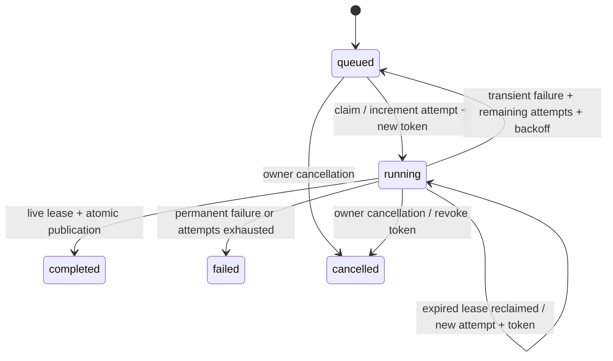

# P1.1 / Task 01 — durable document job foundation

2026-10-20. Verified base: `4a233a373d208093e5321d7f251cd6154fdf3509`
(PR #10). Branch: `feat/p1-student-durable-jobs`.

Status: implemented foundation for independent review, **not production readiness**.
This task's owner instruction supersedes the older Student plan's milestone ordering.
No complete Student experience, P1.2 executor, production deployment, paid provider,
external queue or ruleset change is included.

## Audit and deliberate scope

Reuse existing Database/AsyncSession, UTC/UUID types, owner authentication, Project
ownership, DocumentRevision identities, K1 normalization, rate limiting and HTTP error
contracts. K1 parses via API-local threads and its IngestionRunner resumes document
statuses at startup. That runner has no leased job/fencing contract. K2 uses current
KnowledgeDocument revisions/chunks; reindexing an unchanged source reuses its existing
revision. It is unsafe to silently make that multi-stage pipeline a fenced worker.

**This foundation does not route existing uploads/reindex operations into jobs.**
The only new processor contract is `stored-normalized-text/v1`: a bounded snapshot
of an existing revision's already normalized text. No native parser, website fetch,
provider, tool installation or generated-code execution is called. There is **no
registered daemon, poller, startup consumer or public worker endpoint**. Enqueue
persists a queued record; future approved worker integration must consume it using
the internal service. Do not present a queued record as an automatically running
Student ingestion feature.

The public control plane can enqueue, inspect, cancel and inspect a completed
publication. Trusted test/operator processes can exercise claim/heartbeat/fail/publish
through DocumentJobs. This closed contract verifies durable orchestration without
exposing new hostile parsing before the required isolation architecture exists.

## Scope and authentication

The repository has one-owner authentication and user-owned Projects, **no Workspace
or shared workspace membership model**. Here the required namespace is explicitly
`(authenticated user_id, project_id)`; `project_id=null` means the owner's inbox,
not all projects. A project-scoped job requires that exact project on every API
operation. The service revalidates document-to-owner/project and project ownership.
Input revision must belong to that document. Unknown and other-scope IDs return the
same 404. A job ID is never sufficient authority.

This enforces user/project namespace separation, not a claim that Project supplies
multi-user workspace membership. Shared workspace rollout still requires a separately
reviewed identity/membership model. Claiming also joins the pinned revision, hash,
document and owner/project scope, and only selects the installed processor version.

Worker lease tokens are internal capabilities and never included in JobOut. Owner
HTTP routes cannot claim, heartbeat, fail or publish. Request schemas forbid arbitrary
fields such as commands, parser versions and retry budgets. Existing edge authentication
runs before body consumption, including the new enqueue route.

## Database and migration

Migration **0016**, after 0015, adds only:

- `document_jobs`: user/project/document/revision scope, immutable input file hash and
  normalized-text SHA-256, processor version, state, attempt budget, availability,
  token/expiry, worker identifier and bounded safe failure category/message.
- `document_job_publications`: unique job ID, pinned source revision/version, exact
  normalized text snapshot, text/result SHA-256 and bounded citation offset spans.

A unique `(document_id, input_revision_id, parser_version)` key makes enqueue idempotent,
including after terminal states. Repeated enqueue does not reset attempts or revive a
cancelled/failed job. Retry budgets are pinned at enqueue: default 3, server-constructor
range 1..5; owners cannot increase them through HTTP. Leases default to 60 seconds,
server range 5..300. There are state/attempt/lease CHECK constraints and separate queue,
lease-expiry and owner/project scope indexes. A unique publication job key prevents
multiple results. Foreign-key cascades remove jobs/publications when their authorized
source document/project/revision is deleted.

PostgreSQL migration explicitly revokes new-table privileges from PUBLIC and existing
anon/authenticated roles, preserving the earlier lockdown. Existing tables, schemas,
revisions, vectors and grants are not rewritten. No backfill or automatic scheduling
of old documents occurs. Downgrade drops these new job/publication records: back them
up before any future authorized real-data rollback. Only throwaway databases were
migrated/downgraded during this task.

## Lifecycle, leases and fencing

Every operation owns a fresh short database transaction. No parsing/network/provider
call occurs inside it. PostgreSQL claim uses `FOR UPDATE OF knowledge_documents,
document_jobs SKIP LOCKED`, then validates scope; it releases locks on returning the
Lease. Active future leases cannot be claimed. Expiry itself revokes heartbeat,
failure and publication rights, even before a replacement claims the job. Lease
recovery increments the attempt and creates a fresh UUID token. Fencing requires
that exact token, attempt, revision, version, user/project scope and live expiry.
Database clock time, not worker wall-clock time, decides expiry; PostgreSQL uses
clock_timestamp after acquiring locks rather than a stale transaction-start time.

Heartbeat extends a live lease only. Transient failures retry after bounded 5/10/20/40
second backoff (60-second cap); permanent failures terminate immediately. Crashes also
consume attempts. A claim poll marks expired final attempts failed, with at most 100
such cleanup transitions per transaction before another poll. Raw exceptions/secrets
are not accepted as persisted errors: only fixed safe categories/messages.

Cancellation is immediate logical revocation, not a promise to kill native processes.
A running cancelled job loses its token. Queued cancelled jobs cannot be claimed.
Repeated cancellation is stable; a completed publication cannot be cancelled away.
Cancel versus publish serializes on document/job locks: exactly one terminal outcome
wins. Physical process cancellation remains part of the unresolved D4/D7 boundary.

SQLite is a **single-worker development fallback**, not PostgreSQL throughput or
locking emulation. Mutators use BEGIN IMMEDIATE before any selection in a dedicated
session, serializing writers at the database. No Python-only lock is relied on across
restarts. SQLite does not implement SKIP LOCKED; its specific PostgreSQL lock test is
skipped there. Configure PostgreSQL before running concurrent production consumers.

## Immutable publication and citations

A publication is an append-only **processing revision**, separate from K1's
DocumentRevision and search activation. It does not change current_revision_id,
KnowledgeChunk, vectors or K2 citation metadata. This avoids a partial search-index
switch or silently rewriting previously cited source content. A future task must
explicitly design staged K1 ingestion and atomic search activation; this service
alone does not make the old pipeline fenced.

Limits: 2,000,000 Unicode code points of normalized text, 1,000 ordered nonoverlapping
spans. SQL length predicates reject oversized legacy revisions before materializing
source text in the API/worker process, both on enqueue and publication. Each span satisfies `0 <= start < end <= len(text)`. Offsets address the exact
stored snapshot in **Unicode code points**, not bytes/UTF-16 or separately normalized
text. Current v1 requires output text equal to the pinned source revision, canonical
under the existing K1 normalizer, and matching the enqueue-time text SHA-256 and file
hash. Source-row mutation is detected. The v1 processor identifier describes this
stored-text publication contract; legacy native parser versions are unknown, not
retroactively invented. Page/chapter/heading locators are deliberately absent here.

The result digest covers both text and spans. Within one fenced transaction the
service inserts the immutable publication and changes the job to completed. A database
failure rolls both back. Deadline is checked again before publication state changes.
An original valid completion retried after a lost acknowledgement returns the same
publication (including after its old lease time passes); a different result conflicts.
An expired, replaced, cancelled or wrong-scope worker cannot publish. New processor
versions create distinct jobs/publications; historical results are retained. Future
rollouts must drain/cancel old-version jobs or retain a compatible worker, not execute
them with an arbitrary new processor under an old version label.

## Owner API

- POST `/api/knowledge/documents/{document_id}/jobs` with `revision_id` and explicit
  `project_id` for project scope; returns the stable job, no worker token.
- GET `/api/knowledge/document-jobs/{job_id}?project_id=...`.
- POST `/api/knowledge/document-jobs/{job_id}/cancel?project_id=...`.
- GET `/api/knowledge/document-jobs/{job_id}/result?project_id=...&offset=0&limit=4000`;
  maximum text page 8,000 code points, with bounded global offset metadata. It reads
  already published text and never runs a parser/provider.

No Student UI, reading manifest, EPUB support, quizzes, learning progress, native
worker CLI, Redis, Celery or external service was added.

## Verification and review evidence

Final **local** results on the retained code (843 API cases collected per backend):

| Check | Passed | Failed | Skipped |
| --- | ---: | ---: | ---: |
| API SQLite, including existing K1/K2/native suites | 837 | 0 | 6 |
| API PostgreSQL 16 + pgvector | 842 | 0 | 1 |
| Focused SQLite job contract tests (overlaps full suite) | 36 | 0 | 1 |
| Frontend/shared unit tests | 65 | 0 | 0 |

SQLite skips: 2 PostgreSQL role checks, 1 SKIP LOCKED test, migration lock, 2 pgvector
operator cases. PostgreSQL skips the SQLite-only fallback case. No OCR/Office test
was skipped in either final full suite. There are **37 new job regression cases**;
counts from overlapping focused/full suites must not be added together.

The oversized-source ORM-load regression failed before the SQL read guard and passes
after it; rejecting only after loading the full source was insufficient.

The new cases cover API/engine restarts; concurrent claimers; an actual PostgreSQL
row lock; expired lease recovery; stale/expired/cancelled worker rejection; heartbeat;
bounded retries and crashes; idempotent and conflicting completion; atomic rollback;
cancel/publication races; owner/project/document/revision negatives; forbidden worker
fields; pre-body authentication; exact Unicode offsets; immutable results across
source/processor changes; pinned source-text mutation; safe errors; deletion; SQLite
serialization; and bounded configuration.

Ruff lint/format pass (400 Python files); mypy passes (275 source files). Frontend
lint/types pass. Upgrade/check/downgrade/upgrade/check pass on fresh SQLite and local
PostgreSQL; no new schema drift. PostgreSQL's existing vector reflection warning
remains. anon/authenticated have no DML privileges on either new table.

API Docker build passes. Image:
`sha256:736da3b8e1a7a02e884568ff0edeb724e437b66507f2424546f782eabc2e1add`.
A real container smoke applies 0016, checks auth 401/200 and tini PID 1, exits a trusted
one-shot worker after claiming, restarts the API container with that running job,
fault-expires its lease, then uses a second worker process to reclaim attempt 2 and
publish exact source text/offsets. It verifies graceful SIGTERM shutdown (Uvicorn's
normal 143 exit). These are local controlled stored-text tests, no native job worker.

Runtime pip-audit and production pnpm audit have zero known findings. Trivy on that
image still reports **79 HIGH / 1 CRITICAL**, zero fixable HIGH/CRITICAL. No finding
was suppressed or gate weakened. Full-history secret scan and hosted run details are
recorded in the final handoff after commits/push. Desktop/mobile Playwright and web
Docker rebuild are not claimed as local runs in this iteration; full hosted CI keeps
them enabled. Hosted success is never inferred from the local counts above.

## Remaining gates

D6 (4 GiB virtual limit/aggregate RSS), D4 (setsid escape), D7 (physical cancellation
and one document-wide deadline), and native-library exposure, including LibreOffice's
system libxml2, remain as reported in P0_SECURITY_FIXES_REVIEW.md. No sandbox claim
is made. Do not attach native ingestion to a production consumer until separately
reviewed isolation, aggregate budgets, cancellation and durable fenced K1 activation
exist. A live heartbeat alone is not a document-wide deadline. Large-document staging,
backpressure/operational supervision, native parser identities and shared-workspace
membership are later approved tasks, not completed Student features.

This branch is for independent Antigravity and ChatGPT review. No merge, auto-merge,
deployment, ruleset modification, production credentials or paid APIs were used.

## Changed files

| File | Purpose |
| --- | --- |
| apps/api/src/ezo_api/db/models/document_jobs.py | Job state/lease constraints and immutable publication schema |
| apps/api/src/ezo_api/db/models/__init__.py | Register both models with existing metadata |
| apps/api/migrations/versions/0016_durable_document_jobs.py | Add private tables, queue/lease/scope indexes and reversible schema changes |
| apps/api/src/ezo_api/knowledge/jobs/__init__.py | Explicit database-only package boundary |
| apps/api/src/ezo_api/knowledge/jobs/service.py | Owned transactions, claims, fencing, cancellation, retries and atomic publication |
| apps/api/src/ezo_api/schemas/document_jobs.py | Strict owner API and Unicode offset contracts |
| apps/api/src/ezo_api/api/routes/document_jobs.py | Enqueue/status/cancel/bounded result control plane |
| apps/api/src/ezo_api/main.py | Register the authenticated router; no worker startup |
| apps/api/tests/integration/test_document_jobs.py | 37 lifecycle, contention, isolation and integrity cases |
| .github/workflows/ci.yml | Narrow push trigger for this branch, preserving all checks |
| .github/workflows/security.yml | Same narrow branch trigger and job-source audit paths for current-head security checks |
| docs/P1_STUDENT_DURABLE_JOBS.md | Architecture, local evidence, limits and review handoff |
