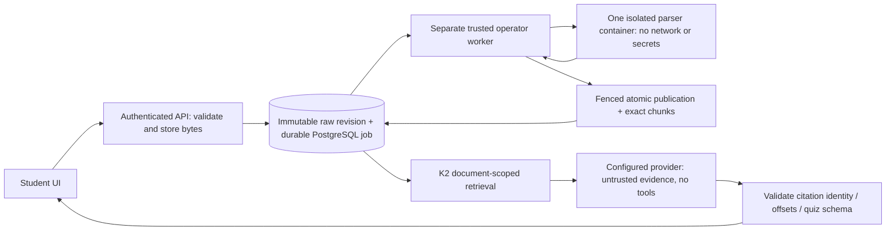

# Student Deep Reading V1 — independent review handoff

Branch: `feat/student-v1-complete`; integration base:
`16a4ae96dd4a436a5170c357e3de6222f8ef8136`.
This document describes a review candidate, **not production readiness or deployment**.
The detailed public interface and Antigravity ownership boundary live in
[integration/STUDENT_AGENT_CONTRACT.md](integration/STUDENT_AGENT_CONTRACT.md).

## Verified baseline and implementation decisions

Inspected the actual merged #11–#16 changes: durable queue/migration 0016, source
budgets, SQL pagination/ownership/contention fixes, fail-closed native API,
operator executor, atomic daemon admission/recovery and certifi/system CA fix.
Reused their contracts instead of routing raw documents into the legacy K1 parser.

New migration 0017 adds one bounded raw-input table referencing an immutable
DocumentRevision. Source registration, raw bytes and initial job commit together.
Same-user registrations serialize on the user row for scoped idempotency; no lock
is held during parsing. A source revision remains empty normalized text plus its
raw SHA256. Successful extraction creates a **different output revision**.

`StudentIngestion` selects the installed native processor version using the
existing DocumentJobs locking/fencing service. StoredTextWorker cannot claim it.
Legacy K1 startup recovery, direct ingestion and reindexing exclude Student-managed
raw documents; they cannot race or overwrite the fenced Student index.
Native publication validates source bytes/hash, lease token/attempt/expiry and exact
extraction offsets. Output revision, chunks, publication and completed state commit
atomically. K2 sees only the current indexed revision. An index batch checks that
revision again after a provider call before upserting vectors.

## Budgets and recovery

Input 5 MiB, extracted text 2M code points, 1000 source sections, at most 3000
1200-character exact index slices. EPUB follows spine order, preserves member
provenance and bounded heading text; PDF pages and DOCX headings are retained when
available. No fabricated pagination, arbitrary file references or archive extraction.

The inherited executor enforces 768 MiB aggregate memory, zero additional swap,
64 PIDs, one CPU, 128 MiB private tmpfs, read-only filesystem, no network, dropped
parser capabilities and no-new-privileges. Its root-owned 25-second watchdog and
PID-namespace teardown survive controller death and detached descendants. The
controller's immutable container IDs, daemon-wide slot and nonce recovery remain.

The worker has a 90-second whole-job budget within a 120-second nonextended lease.
A 250 ms nominal DB poll notices cancellation, lease loss and graceful shutdown.
It signals physical cancellation and **joins the controller thread before returning**;
it never cancels/detaches a to_thread Future and claims another job while it runs.
On controller/worker SIGKILL, the existing independent watchdog bounds running
work; unused created containers are reconciled after the existing 120-second grace.
DB failure stops the worker safely rather than logging source-bearing SQL exceptions.
A failed cleanup stops the entire worker with its running lease fenced; it cannot
claim another job after an unknown cleanup outcome. Pre-start isolation/identity/slot
configuration errors refund the unadmitted claim and stop the worker for operator repair.

Atomic slot rejection starts no workload: only this fixed `executor_busy` category
refunds an unadmitted claim and defers it two seconds, revoking its token. Unknown
or uncertain failures consume the normal bounded retry budget. This prevents healthy
queued jobs failing solely because another controller owns the one slot.

Explicit terminal retry creates a new raw revision/job generation. Existing failure,
cancellation, attempts and publications remain intact. At most three generations
and three admitted attempts per document; old-generation retry requests return the
same successor. No automatic revival/reset of terminal jobs.

## Learning and UX scope

`/student` adds Uzbek-first upload, library/status, cancellation/retry, Unicode reader,
page/section navigation, document questions, excerpt-based summaries/guides and simple
interactive quizzes. Pagination respects Unicode code points even for emoji in JS.
Only one small navigation entry touches the shared shell; other agents/features are
not registered or rewritten. Uzbek/English/Russian are explicit learning languages.

K1-compatible exact chunks support K2 keyword retrieval immediately. An explicit
32-chunk semantic-index batch uses existing embedding/vector adapters; the UI can
iterate/resume batches. No embedding API is automatically called during raw parsing.
Answers use bounded K2 context; guides/summaries/quizzes use at most six chunks of a
selected section, explicitly **excerpt-based** rather than complete-book analysis.
Citation source identity/current revision/exact source substring are checked. Model
claims are not independently proven true, and pedagogical quality requires evaluation.
Missing/invalid citations or malformed quiz output fail safely; insufficient retrieval
returns an evidence shortage. No provider returns 503 instead of fake AI success.

All generated/model and document content is data, never code, tool/action approval,
installation permission or repository/deployment authority. The Student path exposes
no tools. No production keys or paid services were used in verification.

## Review sequence and remaining gates

1. Review migration 0017 and registration/retry atomicity, including concurrent requests.
2. Review inherited locking order and native publication fencing; run real PostgreSQL
   contention tests (SQLite does not establish SKIP LOCKED behavior).
3. Run `scripts/test_isolated_executor.py --api-image <current-built-api>` with the API
   venv Python. It includes actual isolated PDF/DOCX/EPUB → DB/index → mock-model
   answer/citations → guide → quiz, plus native cancellation/lease-revocation cases.
4. Review worker deployment topology **before any activation**. The CLI's acknowledgement
   is an operator contract, not a way to prove a physical host is dedicated. Do not
   share its daemon with privileged/untrusted clients or mount its socket in the API.
   Shared-host root threats, kernel isolation and remote worker transport require a
   separate security/operations review. No such host was provisioned here.
5. Review UI browser tests separately from model accuracy. One browser test explicitly
   mocks the AI HTTP response; the backend container tests use actual parsing and only
   mock providers. No live-provider answer/embedding quality has been measured.
6. Review [STUDENT_V1_DEPENDENCY_RISKS.md](STUDENT_V1_DEPENDENCY_RISKS.md). The 44 unpatched
   HIGH package findings are retained; green fixable-only gates do not mean zero risk.

Known limits: no scanned-PDF OCR, larger-than-budget documents, whole-book exhaustive
synthesis, automatic provider health proof, shared workspace membership, cross-source
Student learning, persistent quiz progress or durable semantic-index jobs. Semantic
batches are explicit/resumable by offset; tab closure stops future batches. These
limits must not be advertised as completed functionality. Existing global K1/K2
features remain separate. Production native activation remains disabled/pending a
reviewed dedicated runtime. No merge, auto-merge, deployment or ruleset change.
