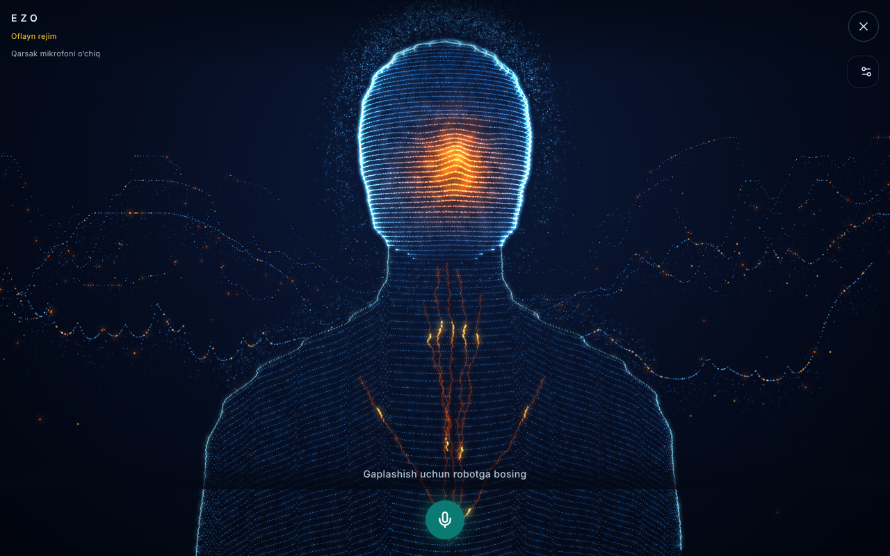
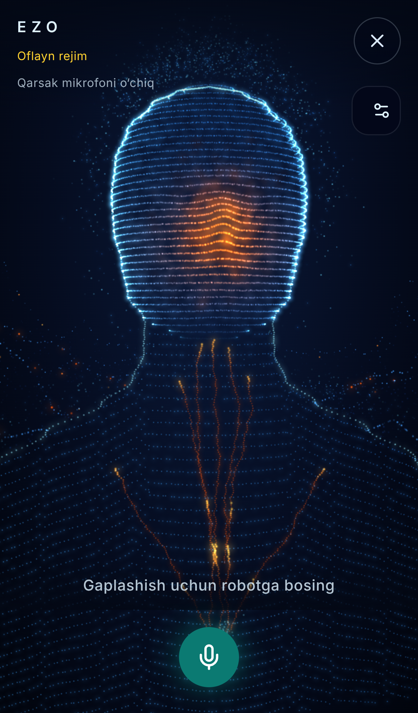
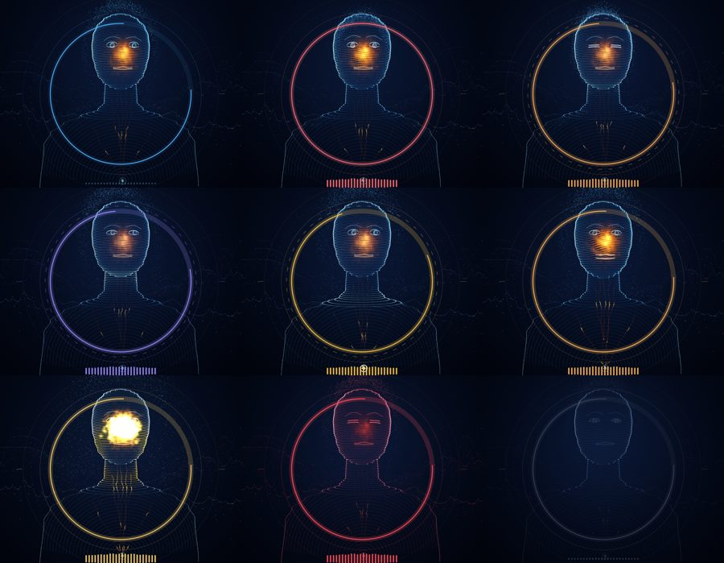
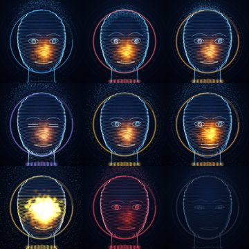
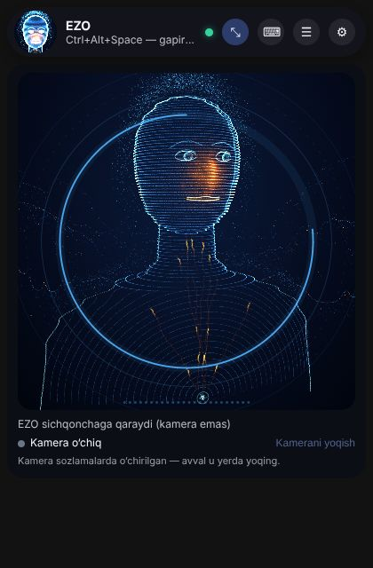
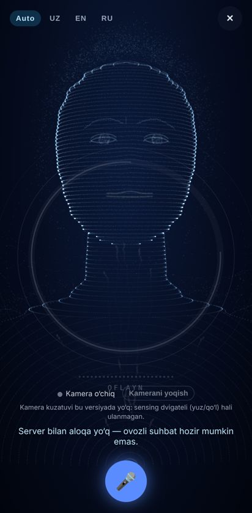
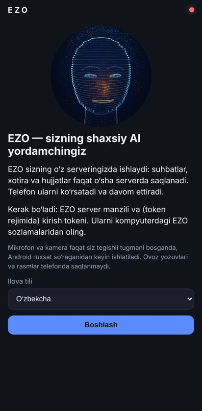

# EZO's humanoid face and trilingual voice

EZO now appears as a glowing particle humanoid: a head and shoulders drawn from contour
lines, with a warm "voice light" in the face and mountains of light behind it. The same
face is used on the web voice stage, on the Windows pill and on the Android voice screen.
It listens, thinks and speaks in **Uzbek, English and Russian**.

| Web voice stage | Android voice screen | Windows pill (idle, listening) |
|---|---|---|
|  |  |  |

These are real renders made by the code in this repository, using Chromium's WebGL
(SwiftShader) and a synthetic microphone tone.
- The web image is the production build in the end-to-end test setup.
- The Android image is the built web layer of the APK, opened in a phone-sized browser.
- The Windows image is the desktop pill's own HTML.

**They are not photos of a physical phone or PC.**

## Bust reshape (2026-10-28, owner request)

The owner asked for a less childish, more lifelike bust, sending a phone screenshot of a
reference holographic humanoid. EZO's figure is still our own procedural code; nothing was
copied from the reference. What changed:
- a strong neck that flows into sloping trapezius lines and broad shoulders (the old thin
  neck on flat rings looked like a chess pawn);
- neck, shoulder and chest contours follow the outline instead of concentric arcs;
- face contours bend over brow, nose and lips; the warm light is wider and a little lower;
- contour lines are brighter across the front, not only at the rim; mountains brighter, a
  few more warm sparks, fewer dust points to stay inside the point budgets;
- a cheap bloom: a share of the points is drawn a second time as wide, faint sprites
  (never in economy mode; earned at runtime: it switches on only after 30 frames above
  ~50 fps and off for the session if frames then fall below ~40 fps, so software rendering
  such as CI's SwiftShader never pays for it; `data-glow` on the canvas says which. The
  renders below were taken with the glow pass forced on, as a GPU shows it); stronger veins and face light; a denser crown spray; a cluster
  of sparks on the sternum where the veins meet.

| Desktop 1280×800 | Phone (iPhone 13 profile) |
|---|---|
|  |  |

Renders from the Playwright e2e setup (Chromium SwiftShader, no voice provider, so the
status reads "Oflayn rejim"). Not photos of a device.

## How the face works (`packages/avatar`)

The package is framework-free TypeScript using WebGL 1, with no dependencies, so it runs
in Next.js, Electron and the Android WebView.

**Figure** (`figure.ts`)
- Built once: 45,488 points at high quality and 19,629 at low quality on the voice stage
  (holographic style; the Performance table below is from the earlier 49,034 / 18,630 figure), made of:
  - head contour rings shaped by a head profile (crown, temples, cheekbones, jaw, chin) and
    a light face relief that the lines bend over;
  - one family of contour lines for the neck, trapezius, shoulders and chest that follows the
    outline (level under the jaw, sloping over the shoulders, dipping towards the sternum);
  - a bright silhouette edge and a particle halo;
  - warm veins in the neck, soft glow sprites in the face;
  - ridge lines of mountains.
- A filled silhouette writes depth only, so the mountains do not shine through the body.

**Face** (`face.ts`, `figure.ts` addFeatures; Section B, 2026-10-27)
- Explicit features drawn in front of the contour surface: two almond eyes (outline, iris
  ring and fill, pupil) whose irises follow the gaze — the eyes lead the head and go a
  little further; upper lids that blink every 2–6 s (more often when attentive), fully
  close in 0.07 s and reopen in 0.13 s, and droop half shut when offline; brows that rise
  with attention and lower (inner ends most) in thought and work; lips whose lower line
  and the jaw of the contour rings below open with the **measured** voice level (the
  microphone level never opens EZO's mouth; only its own speech does), with the corners
  lifting on success and dropping on error.
- A soft key light from the upper left shades the head and neck by their normals.
- Without a live level (the browser's own voice), the speech rhythm is animation only and
  is drawn fainter; nothing presents it as a measurement.
- `face.ts` is pure (blink curve, eye target, brow/mouth/smile/droop amounts) and tested
  without a GPU; the 2D still fallback draws the features too.

| Nine states, bust framing | Nine states, head framing (pill) |
|---|---|
|  |  |

Row by row: idle, listening, recognizing / thinking, working, speaking / success, error,
offline. Real renders of `packages/avatar/demo` in Chromium (SwiftShader), with a gaze of
(0.6, 0.2) in the head sheet so the eyes and head turn.

**Motion** (`shaders.ts`)
- All animation runs on the GPU.
- The face lines ripple with the voice level, and the halo drifts. While EZO listens the
  halo is drawn in; while it thinks a scan wave runs down the figure.
- Pulses travel up the veins. An error tints the figure red.

**States** (`states.ts`)
- Nine looks: `idle`, `listening` (halo drawn in, head leans towards you), `recognizing`
  (the recording is over and the server is turning it into words), `thinking` (slow scan),
  `working` (a tool or device is doing real work: fast two-way scan, gold chest light,
  quick pulses up the veins), `speaking` (face ripples with the voice), `success` (a gold
  ring leaves the chest; returns to idle by itself after 1.6 s), `error` (red), `offline`
  (grey, dim, still).
- Every app state maps onto one of these; server-reported tool stages (searching,
  reading, coding, creating) show the working look, not the thinking look.
- The look eases smoothly from one state to the next.

**Gaze** (`avatar.ts`)
- `setGaze({yaw, pitch})` turns the head (±0.35 rad) towards a normalised point: the
  pointer or a touch over the figure. A gaze older than 1.5 s drifts back to the idle sway.

**No camera (2026-10-28, owner decision)**
- Face and hand tracking were removed from the code: the `packages/face-tracking` engine
  (MediaPipe in a worker), the vision assets, the camera controls on every stage, the
  Android `CAMERA` permission for tracking, the `wasm-unsafe-eval`/`worker-src` CSP and the
  camera specs. Reason: it made the figure lag on the owner's hardware. The Android photo
  button (`@capacitor/camera`, "explain this photo") is a different feature and stays.
- The clap stays: `@ezo/perception-client` holds the microphone-only clap detector
  (`ClapMicrophone` → `ClapDetector`, an AudioWorklet; nothing recorded or uploaded) and the
  spoken acknowledgement (`AcknowledgementSpeaker`, real `/api/voice/speak`, cached per voice
  and language). Separate consent, off by default, its own Stop; a hidden view stops it.
- CSP: `script-src … blob:` only for the clap AudioWorklet module the page makes itself;
  `Permissions-Policy: camera=()` on the web; the Windows pill grants the microphone only.
- CI runs the clap with a fake microphone file of clap-like bursts
  (`tests/e2e/specs/clap.spec.ts`, project `clap`): a SIMULATION, never a real room.
- Economy: `power: "low"` caps drawing at 30 fps (auto on devices reporting ≤4 GB,
  data-saver or ≤2 cores; a setting on Windows and Android); `setActive(false)` stops the
  loop in hidden hosts.

| Windows stage (expanded pill) | Android voice stage | Android welcome |
|---|---|---|
|  |  |  |

Real renders of the built renderers (Electron pill HTML in Chromium with a fake bridge;
the APK's web layer in a Pixel-7-sized Chromium). Not photos of a PC or a phone.

**Voice frame** (`frame.ts`)
- A thin ring, an equaliser and a state word around the figure, framework-free SVG. The
  equaliser follows the level the figure is actually drawing (a real measurement where one
  exists; drawn fainter when it is the animated speech rhythm). Pattern adapted from the
  MIT-licensed APEX-UI orb; see `packages/avatar/NOTICE.md`.

**Accessibility**
- With `describe`, the canvas gets `role="img"` and an `aria-label` in the app's language
  that changes with the state; the desktop pill and the Android app pass their own words.
  The web app names its wrapper instead ("EZO — <state word>") and keeps the canvas
  decorative, so a screen reader meets one image, not two.
- `tests/e2e/specs/accessibility.spec.ts` runs axe-core (WCAG 2.x A/AA) over the home
  screen, the voice stage, the pill renderer and the Android app's welcome/settings screens;
  serious or critical violations fail CI. The voice stage is keyboard-operable (talk control
  and mode tabs reachable by Tab/Enter).

**Voice level** (`level.ts`)
- The microphone level drives the face while EZO listens, and EZO's own voice drives it
  while it speaks.
- EZO's voice is measured through `captureStream()`, so playback is never rerouted.
- Where the voice cannot be measured (the browser's own speech, or Safari media
  elements), a speech-like rhythm is animated instead. This is animation only.

**Robustness**
- `prefers-reduced-motion` shows still frames only.
- Drawing pauses while the page is hidden.
- After a lost WebGL context, drawing restarts when the context is restored.
- A still 2D drawing is used where WebGL is unavailable. The web app instead falls back to
  the previous `EzoPresence` orb.

**Origin.** The design follows the owner's reference video (a particle humanoid with a warm
face over particle mountains). The public APEX-UI repository **does not contain** that
humanoid: its README says the humanoid lives in a separate, private repository. This
package is therefore EZO's own procedural implementation. No APEX-UI code, shaders or
assets were copied, and the "Apex" name and branding are not used.

## Performance (measured)

`tests/e2e/specs/avatar-performance.spec.ts` measures the real voice stage in the production
web build. It writes `tests/e2e/reports/avatar-performance.json` and, in CI, a
`Avatar performance` notice. Local session VM and GitHub runner, 2026-10-24:

| Profile | Quality | Points | Figure build | Canvas (CSS → backing) | Frame interval p50/p95 | Avatar draw + `finish()` p50/p95 |
|---|---|---|---|---|---|---|
| Desktop 1280×800 @1x | high | 49,034 | 73–82 ms | 1016×690 → 1016×690 | 66.6 / 116.7 ms (≈16 fps) | 5.7 / 17.7 ms |
| Pixel 7 412×839 @2.625x | low | 18,630 | 33–41 ms | 412×709 → 824×1418 (capped at 2x) | 33.4 / 66.7 ms (≈25 fps) | 7.3 / 15.6 ms |
| Desktop @1x, GitHub `ubuntu-latest` (PR #50 CI) | high | 49,034 | 50 ms | 1016×690 → 1016×690 | 33.3 / 50 ms (≈33 fps) | 7.7 / 16 ms |
| Pixel 7 @2.625x, GitHub `ubuntu-latest` (PR #50 CI) | low | 18,630 | 20 ms | 412×709 → 824×1418 | 16.8 / 50 ms (≈38 fps) | 7.5 / 16.3 ms |

How to read this:
- The numbers come from Chromium's **SwiftShader software renderer on a shared VM**, with no GPU. They are a worst case for machines without graphics acceleration, not phone or PC GPU results.
- The avatar's own draw is a few milliseconds even there. Most of the frame interval is the software compositor drawing the page.
- On a real GPU, 49k points is a light load. A real-device measurement (owner PC and phone) is still pending.

Memory and load (same spec, 2026-10-26): the whole page's JS heap after 4 s of animation is
12.1 MB (desktop) / 10.7 MB (Pixel 7 profile); the figure is built in 30–80 ms and the first
frame follows DOMContentLoaded by well under a second. The spec fails above a 200 MB heap, so
the avatar stays within a sub-16 GB laptop's budget.

The test asserts only hardware-independent budgets:
- at most 50,000 points at high quality and 20,000 at low;
- low quality on dense phone screens;
- the backing store capped at 2× the CSS size;
- a running draw loop.

It records frame times but does not assert them.

## Three languages, no setup

| Step | What happens |
|---|---|
| Listen | **Auto** (the default) sends no language to the recogniser. You can also pin UZ, EN or RU. |
| Recognise | `/api/voice/transcribe` always returns `language`, which is `uz`, `en` or `ru`. If the provider names one of them (for example ElevenLabs `rus`), that is used. Otherwise, including near misses such as Whisper's "turkish" for Uzbek speech, the words decide. Uzbek heard in Cyrillic is shown in Latin script. |
| Answer | The voice turn carries `language_hint`. EZO answers in the language of the words. The hint decides only when the words are ambiguous, such as "Ok" or "2026". |
| Speak | The reply is read in the reply's language. OpenAI `gpt-4o-*-tts` also gets per-language delivery instructions, so Uzbek does not sound Turkish or Russian. Uzbek transcription gets a short Latin spelling prompt. |
| Desktop actions | The local replies ("Kalkulyator ochildi.", "Калькулятор открыт.", "Calculator is open.") exist in all three languages. |

**Detection** (`apps/api/src/ezo_api/core/language.py`)
- Short spoken turns are covered by word lists and script features:
  - Uzbek-only Cyrillic letters (ў қ ғ ҳ);
  - Russian-only letters (ы щ ь);
  - Uzbek q/x;
  - English w/th/c.
- It is tested on short real-world phrases, for example "Xo'p", "Мен уйдаман", "Кто ты?"
  and "Sure, go ahead".

## What is verified, and what is not

**Verified here**
- Unit tests:
  - avatar: 14;
  - API trilingual: 43 tests, plus a chat integration test for the hint;
  - desktop replies and language: 49;
  - mobile client: 9;
  - web: 84.
- End-to-end:
  - the humanoid renders with WebGL on the home screen and the voice stage;
  - a mocked server recogniser hears "Привет, как дела?", and the reply is spoken with
    `language: "ru"`;
  - Uzbek voice turns send `language_hint: "uz"`.
- The full API suite passes.

**Not verified**
- Real speech recognition and voices for all three languages on real hardware. This needs
  the owner's provider keys and a microphone.
- How natural the provider voices sound in Uzbek, which depends on the provider (OpenAI,
  ElevenLabs or VoiceStudio).
- Frame rate on a physical Android phone.
