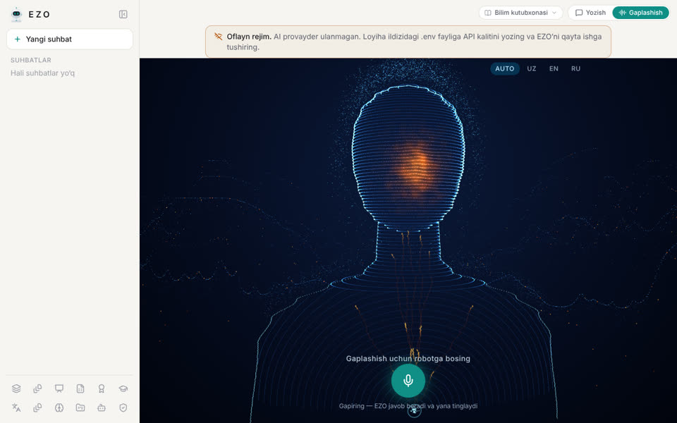
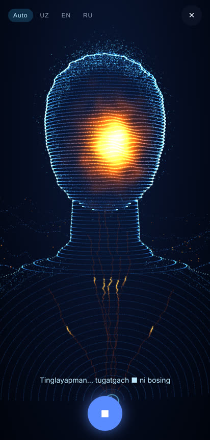
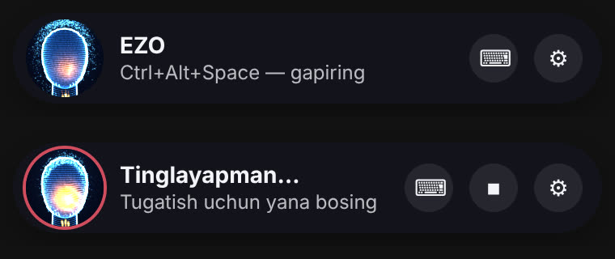

# EZO's humanoid face and trilingual voice

EZO now appears as a glowing particle humanoid: a head and shoulders drawn from contour
lines, with a warm "voice light" in the face and mountains of light behind it. The same
face is used on the web voice stage, on the Windows pill and on the Android voice screen.
It listens, thinks and speaks in **Uzbek, English and Russian**.

| Web voice stage | Android voice screen | Windows pill (idle, listening) |
|---|---|---|
|  |  |  |

These are real renders made by the code in this repository, using Chromium's WebGL
(SwiftShader) and a synthetic microphone tone.
- The web image is the production build in the end-to-end test setup.
- The Android image is the built web layer of the APK, opened in a phone-sized browser.
- The Windows image is the desktop pill's own HTML.

**They are not photos of a physical phone or PC.**

## How the face works (`packages/avatar`)

The package is framework-free TypeScript using WebGL 1, with no dependencies, so it runs
in Next.js, Electron and the Android WebView.

**Figure** (`figure.ts`)
- Built once: 49,034 points at high quality and 18,630 at low quality on the voice stage
  (measured, see Performance below), made of:
  - head contour rings shaped by a head profile (crown, temples, cheekbones, jaw, chin) and
    a light face relief;
  - neck rings and arcs over the shoulders;
  - a bright silhouette edge and a particle halo;
  - warm veins in the neck, soft glow sprites in the face;
  - ridge lines of mountains.
- A filled silhouette writes depth only, so the mountains do not shine through the body.

**Motion** (`shaders.ts`)
- All animation runs on the GPU.
- The face lines ripple with the voice level, and the halo drifts. While EZO listens the
  halo is drawn in; while it thinks a scan wave runs down the figure.
- Pulses travel up the veins. An error tints the figure red.

**States** (`states.ts`)
- `idle`, `listening`, `thinking`, `speaking`, `error`.
- Every app state maps onto one of these; for example, searching shows the thinking look.
- The look eases smoothly from one state to the next.

**Voice level** (`level.ts`)
- The microphone level drives the face while EZO listens, and EZO's own voice drives it
  while it speaks.
- EZO's voice is measured through `captureStream()`, so playback is never rerouted.
- Where the voice cannot be measured (the browser's own speech, or Safari media
  elements), a speech-like rhythm is animated instead. This is animation only.

**Robustness**
- `prefers-reduced-motion` shows still frames only.
- Drawing pauses while the page is hidden.
- After a lost WebGL context, drawing restarts when the context is restored.
- A still 2D drawing is used where WebGL is unavailable. The web app instead falls back to
  the previous `EzoPresence` orb.

**Origin.** The design follows the owner's reference video (a particle humanoid with a warm
face over particle mountains). The public APEX-UI repository **does not contain** that
humanoid: its README says the humanoid lives in a separate, private repository. This
package is therefore EZO's own procedural implementation. No APEX-UI code, shaders or
assets were copied, and the "Apex" name and branding are not used.

## Performance (measured)

`tests/e2e/specs/avatar-performance.spec.ts` measures the real voice stage in the production
web build. It writes `tests/e2e/reports/avatar-performance.json` and, in CI, a
`Avatar performance` notice. Local session VM and GitHub runner, 2026-10-24:

| Profile | Quality | Points | Figure build | Canvas (CSS → backing) | Frame interval p50/p95 | Avatar draw + `finish()` p50/p95 |
|---|---|---|---|---|---|---|
| Desktop 1280×800 @1x | high | 49,034 | 73–82 ms | 1016×690 → 1016×690 | 66.6 / 116.7 ms (≈16 fps) | 5.7 / 17.7 ms |
| Pixel 7 412×839 @2.625x | low | 18,630 | 33–41 ms | 412×709 → 824×1418 (capped at 2x) | 33.4 / 66.7 ms (≈25 fps) | 7.3 / 15.6 ms |
| Desktop @1x, GitHub `ubuntu-latest` (PR #50 CI) | high | 49,034 | 50 ms | 1016×690 → 1016×690 | 33.3 / 50 ms (≈33 fps) | 7.7 / 16 ms |
| Pixel 7 @2.625x, GitHub `ubuntu-latest` (PR #50 CI) | low | 18,630 | 20 ms | 412×709 → 824×1418 | 16.8 / 50 ms (≈38 fps) | 7.5 / 16.3 ms |

How to read this:
- The numbers come from Chromium's **SwiftShader software renderer on a shared VM**, with no GPU. They are a worst case for machines without graphics acceleration, not phone or PC GPU results.
- The avatar's own draw is a few milliseconds even there. Most of the frame interval is the software compositor drawing the page.
- On a real GPU, 49k points is a light load. A real-device measurement (owner PC and phone) is still pending.

The test asserts only hardware-independent budgets:
- at most 50,000 points at high quality and 20,000 at low;
- low quality on dense phone screens;
- the backing store capped at 2× the CSS size;
- a running draw loop.

It records frame times but does not assert them.

## Three languages, no setup

| Step | What happens |
|---|---|
| Listen | **Auto** (the default) sends no language to the recogniser. You can also pin UZ, EN or RU. |
| Recognise | `/api/voice/transcribe` always returns `language`, which is `uz`, `en` or `ru`. If the provider names one of them (for example ElevenLabs `rus`), that is used. Otherwise, including near misses such as Whisper's "turkish" for Uzbek speech, the words decide. Uzbek heard in Cyrillic is shown in Latin script. |
| Answer | The voice turn carries `language_hint`. EZO answers in the language of the words. The hint decides only when the words are ambiguous, such as "Ok" or "2026". |
| Speak | The reply is read in the reply's language. OpenAI `gpt-4o-*-tts` also gets per-language delivery instructions, so Uzbek does not sound Turkish or Russian. Uzbek transcription gets a short Latin spelling prompt. |
| Desktop actions | The local replies ("Kalkulyator ochildi.", "Калькулятор открыт.", "Calculator is open.") exist in all three languages. |

**Detection** (`apps/api/src/ezo_api/core/language.py`)
- Short spoken turns are covered by word lists and script features:
  - Uzbek-only Cyrillic letters (ў қ ғ ҳ);
  - Russian-only letters (ы щ ь);
  - Uzbek q/x;
  - English w/th/c.
- It is tested on short real-world phrases, for example "Xo'p", "Мен уйдаман", "Кто ты?"
  and "Sure, go ahead".

## What is verified, and what is not

**Verified here**
- Unit tests:
  - avatar: 14;
  - API trilingual: 43 tests, plus a chat integration test for the hint;
  - desktop replies and language: 49;
  - mobile client: 9;
  - web: 84.
- End-to-end:
  - the humanoid renders with WebGL on the home screen and the voice stage;
  - a mocked server recogniser hears "Привет, как дела?", and the reply is spoken with
    `language: "ru"`;
  - Uzbek voice turns send `language_hint: "uz"`.
- The full API suite passes.

**Not verified**
- Real speech recognition and voices for all three languages on real hardware. This needs
  the owner's provider keys and a microphone.
- How natural the provider voices sound in Uzbek, which depends on the provider (OpenAI,
  ElevenLabs or VoiceStudio).
- Frame rate on a physical Android phone.
