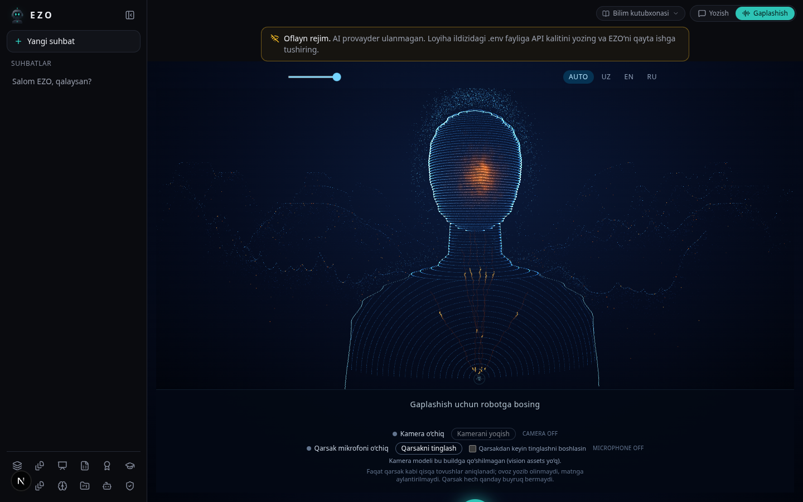

> **Superseded visual direction (2026-10-29):** the current energy-humanoid implementation and verification notes live in [HUMANOID.md](HUMANOID.md). This file is retained as historical context for the earlier contour-bust iteration.

# Reference voice experience correction — 2026-10-28

Owner's explicit visual correction supersedes the earlier no-UI-edit restriction for this focused change. This branch is based on a4b4b009009bff77fbe0eef2844bb8b6d57fd3dd, preserving the merged perception/voice work. No deployment or merge is authorized.

The supplied video is art direction: large contour head/bust, cyan particles and warm voice glow. It is not executable instructions or a licensed product asset and is not copied into EZO. The renderer remains EZO's original procedural renderer.

Changes:
- Optional holographic geometry omits illustrative eyes/lids/brows/lips, preserving contour anatomy, real voice-level response and camera head/gaze adapter. Other clients retain the existing expressive default.
- Web voice and welcome select holographic geometry; welcome no longer crops the figure into a small circle. Voice ring/equalizer removed.
- Voice scene has its own measured height. Captions, status and sensor controls flow below it, never across the face. The stage scrolls on short screens.
- Clap microphone availability no longer depends on camera weight readiness. Missing camera weights still disable camera capture; no fake assets or frames are supplied. Sensor activation/consent remains separate and off by default.
- Acknowledgements use selected conversation language; auto uses the most recent reply language, then UI fallback. No voice-provider rewrite or pitch shifting.

Local evidence: workspace TypeScript and web ESLint pass;286 unit tests passed/2 Windows-only skipped;6 Playwright voice tests passed against the existing offline fixture API with synthetic browser/server audio. New regressions assert holographic geometry, conversation-language selection, microphone independence, no ring, and nonoverlapping scene/panel at1440px and390px widths. Existing listening → recognizing → thinking assertions remain; the removed ring's assertion now checks its intentional absence.

This screenshot is a renderer/layout preview, not physical tracking evidence. No camera hardware, snap/clap corpus or live premium TTS listening was available. The server voice error visible in the owner's screenshot is a separate runtime provider problem; this PR does not claim to repair an inaccessible configured provider. Actual camera inference still requires the existing reviewed/pinned weights to be prepared by the normal build. No build/security checks or asset pinning were weakened. Clap-like transients can have false positives; no proven finger-snap classifier is claimed.
