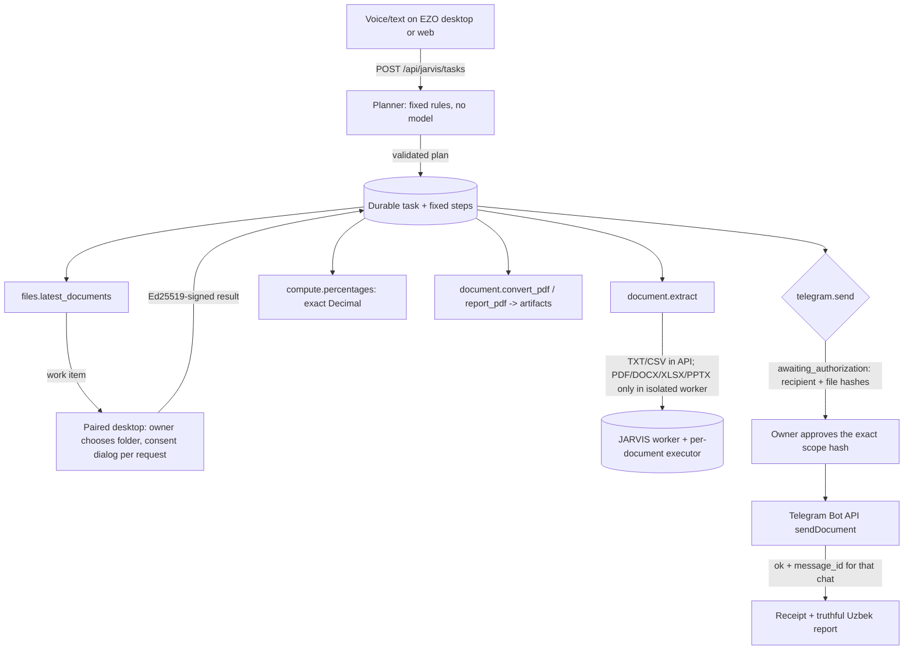

# JARVIS governed task engine (review candidate)

The owner's reference scenario, as real code with real gates:

> "Downloads ichidagi eng oxirgi faylni och, PDF'ga aylantir, foiz ko'rsatkichlarini
> undan oldingi faylga o'xshatib tayyorla va Telegram'da Baxtiyorga yubor."

## Flow

Task states: `queued`, `awaiting_authorization`, `running`, `completed`, `failed`,
`cancelled`. Step states add `pending` and `awaiting_device`.

## Security boundaries

| Boundary | Enforcement | Code |
|---|---|---|
| No model authority | Plans come only from `planner.py` rules; unknown requests are refused with a reason. File contents and model replies never create steps. | `jarvis/planner.py` |
| Device pairing | Device proves key possession (Ed25519 over name/platform/nonce). It stays `pending` until the owner types the 6-digit code shown on the device (10 min, 5 attempts). Revocation fails outstanding work. | `jarvis/service.py`, `device_protocol.py` |
| Device results | Accepted only with a valid signature from the paired key, a matching request id, task, device and action, and before the 5-minute deadline. Declared size and SHA-256 must match the content. No paths are sent. | `device_protocol.py` |
| Local file access | Desktop reads only the newest supported files directly in the one folder the owner chose (no subfolders, no symlinks, ≤ 2 files, ≤ 5 MiB). It reports ties instead of guessing, and shows a consent dialog naming the files before upload. | `apps/desktop/src/main/jarvis.ts` |
| Untrusted documents | PDF/DOCX/XLSX/PPTX are never parsed in the API. Those steps wait for `python -m ezo_api.jarvis.worker`, which uses the isolated executor only. | `jarvis/worker.py` |
| External effect | `telegram.send` waits in `awaiting_authorization`. The approval must echo `scope_sha256` = hash(action, chat id, sorted document hashes). It is single use, and a rejection fails the task. Retry is refused for steps that may have had an external effect. | `service.py::_send`, `decide`, `retry` |
| Telegram truth | Recipients are linked only by the person sending `/start <code>` to the bot, which is a Telegram constraint for bots. "Delivered" is recorded only for `ok: true` with a `message_id` for that exact chat. Timeouts are `delivery_unknown` and never auto-retried. The token is never logged, stored or returned. | `jarvis/telegram.py` |
| Isolation | Every query is scoped to the owner; other users get 404. Tables are revoked from Supabase Data API roles (migration 0023). | `service.py`, `0023_*` |
| Idempotency / limits | `(user, idempotency_key)` is unique, with at most 10 open tasks per owner. | `service.py::create_task` |

## Evidence (this branch)

- API: `tests/unit/test_jarvis_engine_units.py` (planner, Decimal percentages,
  Telegram wire contract) and `tests/integration/test_jarvis_tasks.py` (the whole
  reference scenario over HTTP with real Ed25519 keys, real PDFs, approval hash binding,
  rejection, cancellation, forged/tampered signatures, revocation, ambiguity, delivery
  failure, Office files waiting for the worker, prerequisites, idempotency, owner
  scoping). Passes on SQLite and local PostgreSQL 16.
- Desktop: `jarvis.test.ts` pins canonical JSON to the server's bytes, and checks the
  Ed25519 signature, folder rules, tie detection and work validation. A local
  cross-language check verified desktop-signed pairing and results with the Python
  verifier. Assistant and intent tests cover the voice flow.
- Web: Playwright `jarvis.spec.ts` (9/9 in Chromium against the real API) pairs a
  device in the browser with a real signature and the code shown on the device.

## Live acceptance status

| Item | Status | Needs |
|---|---|---|
| Engine, approvals, receipts (contract) | PARTIAL — implemented and tested with a Telegram wire double | Live Telegram bot token + a person who presses Start |
| Desktop companion on the owner's Windows PC | BLOCKED (live) | Owner installs the build, pairs, chooses Downloads |
| PDF/DOCX/XLSX reading and Office→PDF | BLOCKED (live) | Executor host running `ezo_api.jarvis.worker` (owner approval) |
| Scenario J end to end | BLOCKED | All three of the above, verified on real hardware |

## Owner setup (when approved)

1. Server `.env`: `EZO_TELEGRAM_BOT_TOKEN=<from @BotFather>` (never commit it).
2. Desktop: Settings → JARVIS → choose the Downloads folder → "Bu kompyuterni ulash"
   → type the code on the web JARVIS page.
3. Web JARVIS page: add "Baxtiyor", send him the link, and press "Tekshirish" after he
   presses Start.
4. For PDF/DOCX/XLSX inputs: run the JARVIS worker on the reviewed executor host
   (`python -m ezo_api.jarvis.worker --worker-id jarvis-1 --image sha256:… --ack-dedicated-executor-host`).
